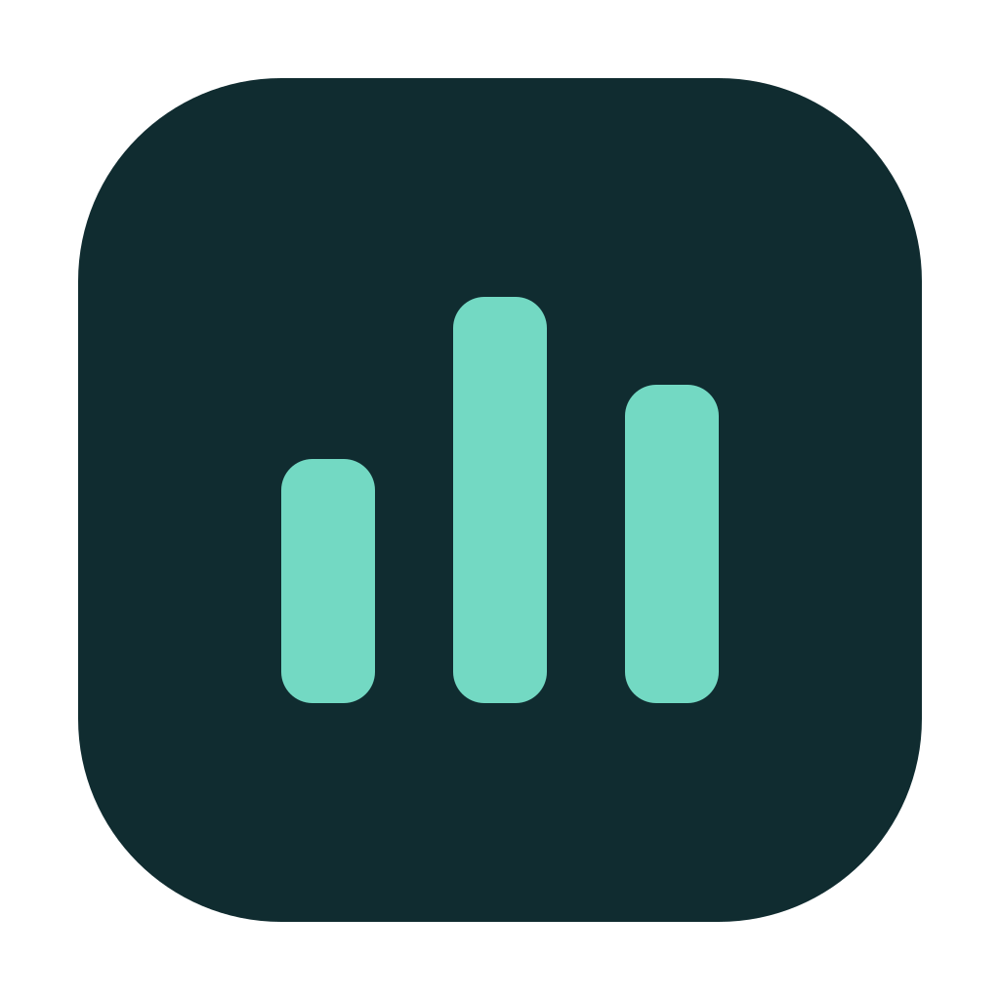
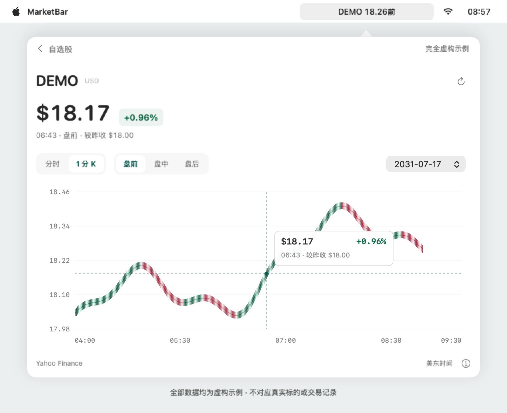

<p align="center"></p>
<h1 align="center">MarketBar</h1>
<p align="center"><a href="README.md" lang="zh-CN">简体中文</a> · <strong>English</strong></p>

Follow a watchlist in your Mac’s menu bar. Click a price to open a line or one-minute candlestick chart. Hover over a minute to see its closing price and percentage change.

**[MarketBar.dmg](https://github.com/ZAIQuQ/marketbar/releases/latest/download/MarketBar.dmg)** · macOS 13+ · Apple Silicon / Intel

<picture>
  <source media="(prefers-color-scheme: dark)" srcset="docs/images/demo-chart-dark.png">
  
</picture>

## Your watchlist

Click a menu bar price and use the sliders button to edit your watchlist. The rectangle beside the bell lets you choose which prices appear in the menu bar. The app’s controls are in Simplified Chinese.

Add up to 12 US stocks, OKX spot pairs or USDT perpetual swaps. Enter a ticker for a stock, the full trading pair for spot, or the contract code ending in `-SWAP` for a perpetual.

## Charts and alerts

**US stocks** have separate premarket, regular and after-hours views. Charts use New York trading dates and show the change from the previous close. By default, a stock leaves the menu bar when trading closes and returns when trading resumes.

**OKX charts** show one-minute candles over rolling windows from 30 minutes to 24 hours. The time axis uses your Mac’s local time. The watchlist shows the rolling 24-hour change. The chart measures change from the UTC day’s open.

**Market alerts** are available from the bell. The panel shows the supported instrument and settings. Qualifying price and volume changes appear in the menu bar and can trigger a silent macOS notification. [Alert settings (Chinese)](docs/ALERTS.md)

US quotes use an unofficial Yahoo Finance feed. Coverage and latency vary by session. OKX quotes come from the exchange’s public feed. Minute records are stored on your Mac and are available offline. [Data sources and storage (Chinese)](docs/DATA_SOURCES.md)

<details>
<summary><strong>Build from source and development commands</strong></summary>

Requires macOS 13 or later and Swift 5.9 or later. Install the Xcode Command Line Tools with `xcode-select --install` if needed.

```sh
git clone https://github.com/ZAIQuQ/marketbar.git
cd marketbar
bash scripts/install.sh
```

The script backs up the previous app, installs to `~/Applications/MarketBar.app` and opens it. To build without installing, run `bash scripts/build-app.sh`.

- Build the universal disk image with `bash scripts/package-release.sh`. The output is `dist/MarketBar.dmg`.
- Offline checks: `bash scripts/check.sh`
- Live feed diagnostics: `swift run MarketBar --diagnose`
- Render the app preview: `swift run MarketBar --preview docs/images`

</details>

## Star History

<a href="https://www.star-history.com/#ZAIQuQ/marketbar&amp;Date">
  <picture>
    <source media="(prefers-color-scheme: dark)" srcset="https://api.star-history.com/chart?repos=ZAIQuQ/marketbar&amp;type=date&amp;legend=top-left&amp;theme=dark">
    
  </picture>
</a>

[Report an issue](https://github.com/ZAIQuQ/marketbar/issues) · [MIT license](LICENSE) · [Third-party notices](THIRD_PARTY_NOTICES.md)
