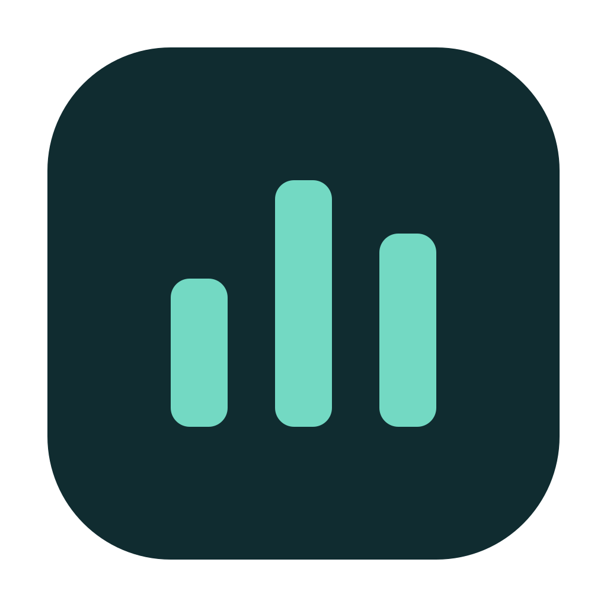
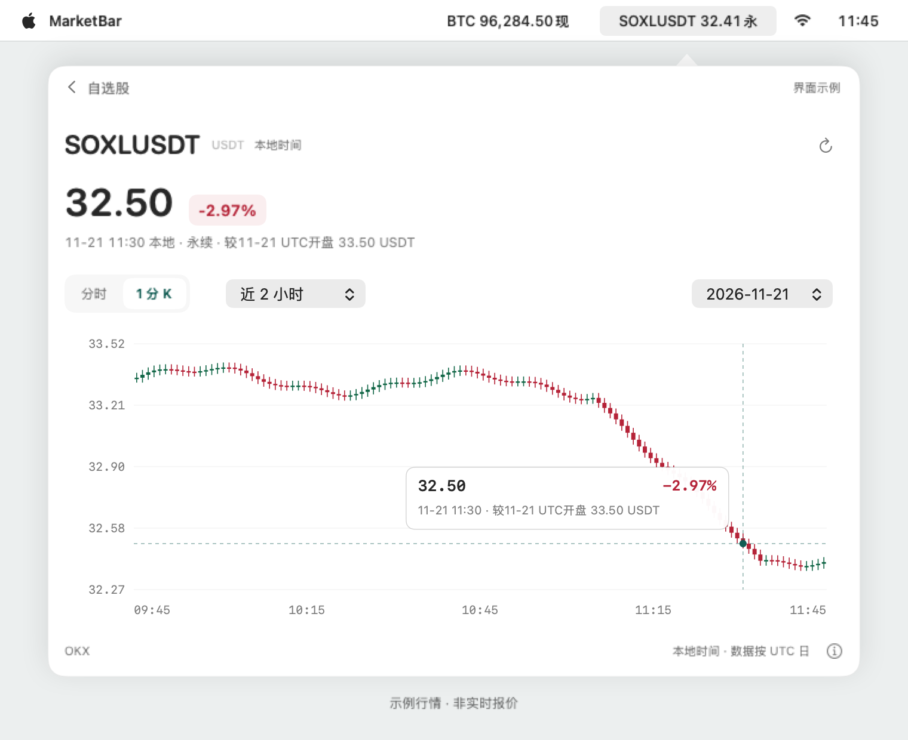

<p align="center"></p>
<h1 align="center">MarketBar</h1>
<p align="center"><strong>简体中文</strong> · <a href="README.en.md" lang="en">English</a></p>

在 Mac 菜单栏看美股、BTC 现货和 SOXL 永续的价格。点开一个品种，就能回看刚才几分钟的走势。

**[下载 Mac 版 ↗](https://github.com/ZAIQuQ/marketbar/releases/latest)**　Apple Silicon · macOS 13 及以上 · 无需行情账号

<picture>
  <source media="(prefers-color-scheme: dark)" srcset="docs/images/marketbar-dark.png">
  
</picture>

## 把第一组行情放进菜单栏

1. 在下载页选择以 `macos-arm64.zip` 结尾的安装包。解压，把 `MarketBar.app` 拖入「应用程序」后打开。发布版尚未经过 Apple 公证。Intel Mac 可按下方说明从源码安装。
2. 点击菜单栏价格，默认自选是 AMD 和 NVDA。点面板右上角的滑杆按钮，在自选框里填入 `AMD, NVDA, BTCUSDT, SOXLUSDT`，点「完成」。
3. 点铃铛右侧的矩形图标，勾选你希望常驻菜单栏的品种。例如只勾 BTC 和 SOXL，其余品种仍可在展开的列表里查看。全部取消勾选后，可从菜单栏的 `MarketBar` 重新打开面板。

| 输入代码 | 看到的行情 |
| --- | --- |
| `AMD`、`NVDA` | 美股，覆盖盘前、盘中和盘后 |
| `BTCUSDT` 或 `BTC-USDT` | OKX 比特币现货，以 USDT 报价 |
| `SOXLUSDT` 或 `SOXL-USDT-SWAP` | OKX 的 SOXL 永续合约，以 USDT 报价 |
| `BTC`、`SOXL` | 对应的美国上市 ETF |

最多可关注 12 个品种。休市美股会自动从菜单栏隐藏，开市后重新出现。想在休市时查看上一笔价格，点开自选列表即可。

## 看一分钟走势

点开自选卡片，在分时线和 1 分钟 K 线之间切换。鼠标移到某一分钟，十字线会显示该分钟的收尾价格和涨跌幅。正在形成的那一分钟会随行情更新。

- **美股**按美东交易日切换盘前、盘中、盘后，图上百分比相对昨收计算。
- **OKX** 可看近 30 分钟、1／2／3／6／12 小时，或 UTC 全天。滚动窗口用本地时间。图上百分比相对当日 UTC 开盘价，自选卡片显示过去 24 小时涨跌幅。

美股报价来自 Yahoo Finance 的非官方接口，延迟和覆盖随时段变化。OKX 使用官方公开行情。菜单栏的 `≈` 表示快照，`旧` 表示报价已超过 60 秒。分钟数据保存在本机，断网时可以回看已有记录。[行情来源与缓存](docs/DATA_SOURCES.md)

## SOXL 放量时提醒我

打开面板顶部的铃铛，点「启用提醒」。MarketBar 会同时关注 SOXL 永续的放量上涨和下跌。默认的一分钟涨跌门槛是 0.6%，连续两分钟是 1.0%，还需达到基准成交量的 3 倍，并持续确认 5 秒。近期波动较大时，价格门槛会提高。

确认后，菜单栏会留下提醒标记，允许 macOS 通知后也可以收到静音横幅。价格门槛、放量倍数和确认时间都可调整。盯盘在这台 Mac 上运行，合盖、睡眠或断网时会中断。[提醒规则与设置](docs/ALERTS.md)

<details>
<summary><strong>从源码安装与开发</strong></summary>

需要 macOS 13 或更高版本，以及 Swift 5.9 或更高版本。可通过 `xcode-select --install` 安装 Xcode 命令行工具。

```sh
git clone https://github.com/ZAIQuQ/marketbar.git
cd marketbar
bash scripts/install.sh
```

脚本会备份旧版，将应用安装到 `~/Applications/MarketBar.app` 并打开。仅构建可运行 `bash scripts/build-app.sh`。

- 离线检查：`bash scripts/check.sh`
- 实流诊断：`swift run MarketBar --diagnose --symbols 'BTCUSDT,SOXLUSDT'`。加 `--monitor --seconds 240` 可观察 SOXL 提醒状态。
- 界面预览：`swift run MarketBar --preview docs/images`

</details>

## Star History

<a href="https://www.star-history.com/#ZAIQuQ/marketbar&amp;Date">
  <picture>
    <source media="(prefers-color-scheme: dark)" srcset="https://api.star-history.com/chart?repos=ZAIQuQ/marketbar&amp;type=date&amp;legend=top-left&amp;theme=dark">
    
  </picture>
</a>

[反馈问题](https://github.com/ZAIQuQ/marketbar/issues) · [MIT 许可](LICENSE) · [第三方声明](THIRD_PARTY_NOTICES.md)
