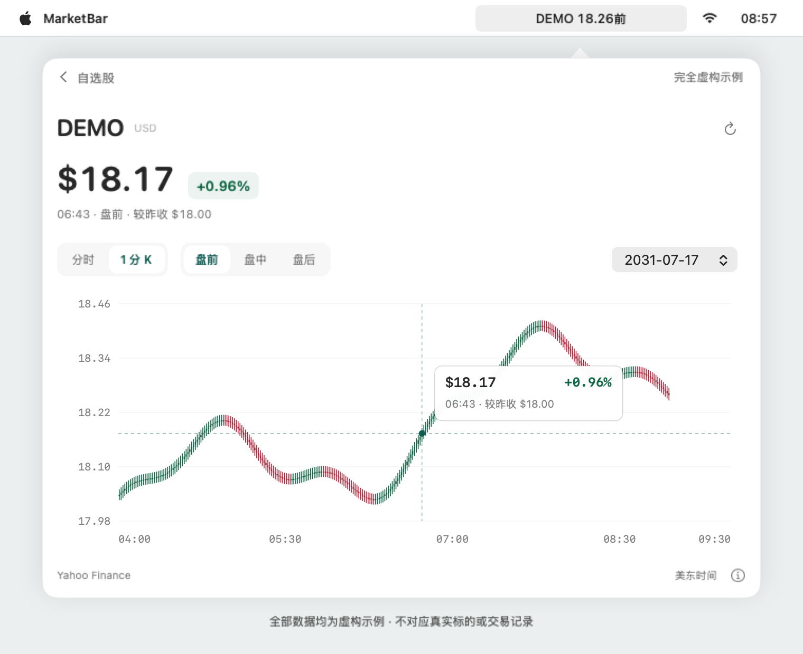

<p align="center"></p>
<h1 align="center">MarketBar</h1>
<p align="center"><strong>简体中文</strong> · <a href="README.en.md" lang="en">English</a></p>

在 Mac 菜单栏查看自选行情。点开价格可看分时走势和一分钟 K 线，移到图上任意一分钟即可查看收盘价和涨跌幅。

**[MarketBar.dmg](https://github.com/ZAIQuQ/marketbar/releases/latest/download/MarketBar.dmg)** · macOS 13+ · Apple Silicon / Intel

<picture>
  <source media="(prefers-color-scheme: dark)" srcset="docs/images/demo-chart-dark.png">
  
</picture>

## 自选行情

点击菜单栏价格，用面板右上角的滑杆按钮编辑自选。铃铛旁的矩形按钮可以勾选常驻菜单栏的品种。

支持美股、OKX 现货和 USDT 永续合约，最多可添加 12 个品种。美股使用股票代码，现货使用完整交易对，永续合约使用以 `-SWAP` 结尾的合约代码。

## 走势与提醒

**美股**可按美东交易日查看盘前、盘中和盘后。图上的涨跌幅相对昨收计算。已休市的股票默认从菜单栏隐藏，开市后恢复显示。

**OKX 行情**可查看近 30 分钟至近 24 小时的走势，每根 K 线为 1 分钟，时间轴使用系统本地时间。列表显示滚动 24 小时涨跌幅，图上显示相对 UTC 当日开盘价的变化。

**行情提醒**可从铃铛入口启用。面板列出支持的监测对象和可调条件。出现符合条件的价格与成交量变化时，应用会在菜单栏标记，也可发送静音系统通知。[提醒设置](docs/ALERTS.md)

美股使用 Yahoo Finance 的非官方接口，行情覆盖和延迟随时段变化。OKX 使用交易所公开行情。分钟记录存于本机，离线时也可回看。[数据来源与缓存](docs/DATA_SOURCES.md)

<details>
<summary><strong>从源码安装与开发</strong></summary>

需要 macOS 13 或更高版本，以及 Swift 5.9 或更高版本。可通过 `xcode-select --install` 安装 Xcode 命令行工具。

```sh
git clone https://github.com/ZAIQuQ/marketbar.git
cd marketbar
bash scripts/install.sh
```

脚本会备份旧版，将应用安装到 `~/Applications/MarketBar.app` 并打开。仅构建可运行 `bash scripts/build-app.sh`。

- 生成适用于两种芯片的磁盘映像：`bash scripts/package-release.sh`，产物为 `dist/MarketBar.dmg`。
- 离线检查：`bash scripts/check.sh`
- 实流诊断：`swift run MarketBar --diagnose`
- 界面预览：`swift run MarketBar --preview docs/images`

</details>

## Star History

<a href="https://www.star-history.com/#ZAIQuQ/marketbar&amp;Date">
  <picture>
    <source media="(prefers-color-scheme: dark)" srcset="https://api.star-history.com/chart?repos=ZAIQuQ/marketbar&amp;type=date&amp;legend=top-left&amp;theme=dark">
    
  </picture>
</a>

[反馈问题](https://github.com/ZAIQuQ/marketbar/issues) · [MIT 许可](LICENSE) · [第三方声明](THIRD_PARTY_NOTICES.md)
